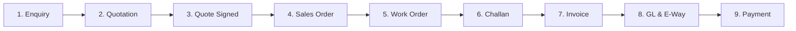

# MNI Assist (AutoReach Web) — Master End-to-End Test Case Document
**Author:** Quality Assurance & Engineering  
**Target Audience:** Junior Developers, QA Testers, Implementation Consultants (No prior project KT required)  
**Applicable Build:** Production & Staging Releases (Angular v21 + Syncfusion + SignalR)  
**Standard Environment URL:** `http://localhost:4200` (Local) / `https://staging.mniassist.com` (Staging)

---

## Table of Contents
1. [Introduction & Tester Onboarding Guide](#1-introduction--tester-onboarding-guide)
2. [Global Test Data Matrix & Test Personas](#2-global-test-data-matrix--test-personas)
3. [Master Numbered Test Case Index (#01 to #55)](#3-master-numbered-test-case-index)
4. [Section 4: Functional Testing (#01 to #27)](#4-section-4-functional-testing)
   - [4.1 Authentication & Workspace (#01 - #04)](#41-authentication--tenant-workspace-management)
   - [4.2 CRM, Contacts & Account 360 (#05 - #07)](#42-crm-contacts--account-360)
   - [4.3 Omnichannel Communications (#08 - #09)](#43-omnichannel-communications)
   - [4.4 Sales Pipeline & Commercials (#10 - #11)](#44-sales-pipeline--commercials)
   - [4.5 Order Execution & Logistics (#12 - #14)](#45-order-execution--logistics)
   - [4.6 Inventory & Purchasing (#15 - #17)](#46-inventory--purchasing)
   - [4.7 Manufacturing & Work Orders (#18 - #19)](#47-manufacturing--work-orders)
   - [4.8 Field Service & AMC (#20 - #22)](#48-field-service--amc)
   - [4.9 Finance & GST Compliance (#23 - #24)](#49-finance-journal-entries--gst-compliance)
   - [4.10 Public Customer Portals (#25 - #27)](#410-public-customer-portals)
5. [Section 5: Integration Testing (#28 to #29)](#5-section-5-integration-testing)
6. [Section 6: User Interface (UI / UX / A11y) Testing (#30 to #32)](#6-section-6-user-interface-uiuxa11y-testing)
7. [Section 7: Performance Testing (#33 to #34)](#7-section-7-performance-testing)
8. [Section 8: System & Compatibility Testing (#35 to #36)](#8-section-8-system--compatibility-testing)
9. [Section 9: User Acceptance Testing (UAT Scenarios #37 to #39)](#9-section-9-user-acceptance-testing-uat)
10. [Section 10: Regression Testing Suite (#40 to #51)](#10-section-10-regression-testing-suite)
11. [Section 11: Security & DPDP Compliance Testing (#52 to #55)](#11-section-11-security--dpdp-compliance-testing)
12. [Section 12: Defect Reporting Guidelines & Bug Template](#12-section-12-defect-reporting-guidelines--bug-template)

---

## 1. Introduction & Tester Onboarding Guide

### 1.1 What is MNI Assist?
MNI Assist is an AI-powered industrial business management and engagement platform designed for manufacturing, equipment engineering, and distributor enterprises. It merges:
- **ERP Core:** Inventory, Purchasing, Bill of Materials (BOM), Manufacturing Work Orders, Financial Accounting, and GST Compliance with E-Way bills.
- **CRM & Commercials:** Accounts, Contacts, Customer 360, Enquiries, Multi-line Quotations with GST logic, Sales Orders, Delivery Challans, and Sales Invoices.
- **Omnichannel AI & Communications:** Real-time WhatsApp messaging, Autonomous AI Voice Agents, Browser Web Call Widgets, and Interactive Voice Response (IVR).
- **Field Service Management:** AMC Contracts, Breakdown Field Tickets, and an Offline-capable Mobile PWA (`/field`) for field technicians.
- **Zero-Auth Customer Portals:** Public links for quotation signing (`/sign/:token`), payment links (`/pay/:token`), spares re-ordering (`/r/:token`), and public support tickets (`/t/:code`).

### 1.2 Layout & Navigation Hierarchy
- **Desktop Sidebar:** Left-hand collapsible menu structured into business domains.
- **Header Top Bar:**
  - **Search Menu:** Instant route finder (`Ctrl + K` or click search box).
  - **Language & Theme Selector:** Switch Light/Dark mode and English / Hindi / Marathi / Gujarati.
  - **Inbox & Notifications:** Real-time bell alerts powered by SignalR.
  - **Profile Menu:** User profile settings, tenant indicator, and **Sign out**.
- **Data Grids:** Powered by Syncfusion. Features include column sorting (click header), column filtering (funnel icon), search bar, pagination controls, and export options.

---

## 2. Global Test Data Matrix & Test Personas

When testing, **always use the standardized sample data below** to avoid colliding with live data and ensure data consistency across relational modules.

### 2.1 Standard Test Personas & Credentials
| Persona Role | Username / Email | Password | Tenant Workspace | Scope of Access |
|---|---|---|---|---|
| **Platform Host Admin** | `hostadmin@mniassist.com` | `HostAdmin#2026!` | *(Leave Blank)* | Multi-tenant control, rate cards, system status, global feature flags |
| **Workspace Admin** | `admin@acme-machinery.com` | `AcmeAdmin#2026!` | `acme-machinery` | Full company workspace access, user management, billing, settings |
| **Sales Representative** | `sales.user@acme-machinery.com` | `SalesRep#2026!` | `acme-machinery` | Contacts, Enquiries, Quotations, Sales Orders, WhatsApp Inbox |
| **Procurement Officer** | `purchase.officer@acme-machinery.com` | `Purchase#2026!` | `acme-machinery` | Suppliers, Purchase Orders, GRN Inward, Vendor Bills |
| **Field Service Tech** | `field.tech@acme-machinery.com` | `FieldTech#2026!` | `acme-machinery` | Field Service tickets, AMC visits, PWA mobile interface (`/field`) |
| **Chief Financial Officer** | `accounts@acme-machinery.com` | `Accounts#2026!` | `acme-machinery` | Journal entries, Invoices, Chart of Accounts, GST compliance, Collections |

### 2.2 Standard Industrial Test Entities
- **Company / Workspace Name:** Acme Machinery & Automation Pvt Ltd (`acme-machinery`)
- **Company GSTIN:** `27AAACA1234A1Z5` (Maharashtra, State Code 27)
- **Primary Customer Account:**
  - Company: `Apex Pneumatics Pvt Ltd`
  - Contact Person: `Rajesh Sharma` (Designation: Plant Head)
  - Phone / WhatsApp: `+91 98200 12345`
  - Email: `rajesh.sharma@apexpneumatics.example.com`
  - GSTIN: `24ABCDE5678F1Z2` (Gujarat, State Code 24 — Interstate Trade)
  - Address: `Plot 42, GIDC Industrial Estate, Vatva, Ahmedabad, Gujarat 382445`
- **Primary Supplier Account:**
  - Company: `Precision Bearings & Spares LLP`
  - Contact Person: `Kavita Patel`
  - Phone: `+91 98980 54321`
  - Email: `orders@precisionbearings.example.com`
  - GSTIN: `27AABCP9988D1Z9` (Maharashtra — Intrastate Trade)
  - Address: `Plot 15, MIDC Industrial Area, Bhosari, Pune, MH 411026`
- **Standard Inventory Items:**
  - **Item A (Finished Machine):** `CNC Automatic Lathe AL-400`
    - Part No / SKU: `MACH-CNC-400`
    - HSN Code: `84581100`
    - Base List Price: `₹ 8,50,000.00` (GST Rate: 18%)
  - **Item B (Raw Sub-Assembly):** `Hydraulic Servo Actuator`
    - Part No / SKU: `ACT-SRV-200`
    - HSN Code: `84122100`
    - Purchase Cost: `₹ 45,000.00` (GST Rate: 18%)
  - **Item C (Consumable Spare):** `Viton O-Ring High Pressure Seal Pack`
    - Part No / SKU: `SEAL-VT-050`
    - HSN Code: `40169320`
    - Base List Price: `₹ 1,800.00` (GST Rate: 18%)

---

## 3. Master Numbered Test Case Index

Every test case in this document is assigned a unique sequential number from **#01 to #55**:

| Test # | Test Code | Category / Module | Test Case Title | Target Path / Route | Priority |
|:---:|---|---|---|---|:---:|
| **#01** | `TC-FUNC-AUTH-001` | Functional / Auth | Standard Workspace User Sign-In | `/login` | P0 |
| **#02** | `TC-FUNC-AUTH-002` | Functional / Auth | Invalid Credentials & Security Error Handling | `/login` | P1 |
| **#03** | `TC-FUNC-AUTH-003` | Functional / Auth | Platform Host Administrator Sign-In | `/login` | P0 |
| **#04** | `TC-FUNC-AUTH-004` | Functional / Auth | Forgot Password & Reset Password Workflow | `/forgot-password` | P1 |
| **#05** | `TC-FUNC-CRM-001` | Functional / CRM | Create New Business Account & Contact | `/contacts/accounts/new` | P0 |
| **#06** | `TC-FUNC-CRM-002` | Functional / CRM | Customer 360 Degree View Validation | `/contacts/accounts/:id/360` | P1 |
| **#07** | `TC-FUNC-CRM-003` | Functional / CRM | Duplicate Contact Detection & Merge | `/contacts/duplicates` | P2 |
| **#08** | `TC-FUNC-COMM-001` | Functional / Comm | Unified Inbox & Real-Time WhatsApp Message Exchange | `/inbox` | P0 |
| **#09** | `TC-FUNC-COMM-002` | Functional / Comm | AI Voice Agent Call Simulation & Inspection | `/calls/ai-agents` | P1 |
| **#10** | `TC-FUNC-PIPE-001` | Functional / Pipeline | Create New Sales Enquiry & Kanban Drag-and-Drop | `/enquiries/new` | P0 |
| **#11** | `TC-FUNC-PIPE-002` | Functional / Pipeline | Generate Multi-Item Quotation with GST Calculation | `/quotations/new` | P0 |
| **#12** | `TC-FUNC-ORD-001` | Functional / Orders | Convert Approved Quotation to Sales Order | `/sales/orders/new` | P0 |
| **#13** | `TC-FUNC-ORD-002` | Functional / Orders | Create Delivery Challan & Generate Dispatch Slip | `/sales/challans/new` | P0 |
| **#14** | `TC-FUNC-ORD-003` | Functional / Orders | Generate Tax Invoice & E-Invoice QR Code | `/sales/invoices/new` | P0 |
| **#15** | `TC-FUNC-PUR-001` | Functional / Purchasing | Create Purchase Order (PO) to Supplier | `/purchasing/orders/new` | P0 |
| **#16** | `TC-FUNC-PUR-002` | Functional / Purchasing | Goods Receipt Note (GRN) Inward & QC Inspection | `/purchasing/grn/new` | P0 |
| **#17** | `TC-FUNC-PUR-003` | Functional / Purchasing | Vendor Bill & Three-Way Match Verification | `/purchasing/bills/new` | P1 |
| **#18** | `TC-FUNC-MFG-001` | Functional / Manufacturing | Bill of Materials (BOM) Setup | `/manufacturing/bom/new` | P0 |
| **#19** | `TC-FUNC-MFG-002` | Functional / Manufacturing | Work Order Execution & Stock Consumption | `/manufacturing/work-orders/new` | P0 |
| **#20** | `TC-FUNC-FSM-001` | Functional / Field Service | Create AMC Contract & Schedule Preventive Maintenance | `/field-service/amc/new` | P1 |
| **#21** | `TC-FUNC-FSM-002` | Functional / Field Service | Service Ticket Lifecycle & Engineer Assignment | `/field-service/tickets/new` | P0 |
| **#22** | `TC-FUNC-FSM-003` | Functional / Field Service | Field Engineer Mobile App (`/field`) Offline Visit | `/field` | P0 |
| **#23** | `TC-FUNC-FIN-001` | Functional / Finance | Post Manual Balanced Journal Voucher | `/finance/journal-entries/new` | P0 |
| **#24** | `TC-FUNC-FIN-002` | Functional / Finance | GST E-Way Bill Generation & Distance Formula Check | `/finance/gst-compliance/eway/:id` | P0 |
| **#25** | `TC-FUNC-PUB-001` | Functional / Public | Customer Quotation Review & Digital Signature | `/sign/:token` | P0 |
| **#26** | `TC-FUNC-PUB-002` | Functional / Public | Customer Public Payment Checkout | `/pay/:token` | P0 |
| **#27** | `TC-FUNC-PUB-003` | Functional / Public | Customer Spares Re-Order Portal | `/r/:token` | P1 |
| **#28** | `TC-INT-001` | Integration | Complete "Lead-to-Cash" Industrial Cycle | Full Journey | P0 |
| **#29** | `TC-INT-002` | Integration | Field Breakdown Ticket to Spares Deduction & Billing | FSM + Stock + Billing | P0 |
| **#30** | `TC-UI-001` | UI / UX | Responsive Breakpoints & Mobile Navigation Drawer | All Viewports | P1 |
| **#31** | `TC-UI-002` | UI / UX | Dark / Light Theme & Multilingual Switching | Header Controls | P1 |
| **#32** | `TC-UI-003` | UI / UX | Form Validation & Inline Accessible Error States | Forms | P1 |
| **#33** | `TC-PERF-001` | Performance | Page Load & Initial Bundle Core Web Vitals | DevTools / Lighthouse | P1 |
| **#34** | `TC-PERF-002` | Performance | High-Volume Data Grid Virtual Scrolling (5000+ items) | `/stock` / `/contacts` | P1 |
| **#35** | `TC-SYS-001` | System | SignalR WebSocket Reconnection After Network Drop | `/inbox` | P0 |
| **#36** | `TC-SYS-002` | System | Cross-Browser Compatibility Matrix (Chrome, Edge, Firefox, Safari) | Core Flows | P1 |
| **#37** | `TC-UAT-001` | User Acceptance | Plant Manager / Operations Head Sign-off | Manufacturing | P0 |
| **#38** | `TC-UAT-002` | User Acceptance | Field Service Engineer On-Site Sign-off | Field App | P0 |
| **#39** | `TC-UAT-003` | User Acceptance | Chief Financial Officer (CFO) GST Sign-off | Finance / Tax | P0 |
| **#40** | `TC-REG-001` | Regression | User authentication with tenant workspace | `/login` | P0 |
| **#41** | `TC-REG-002` | Regression | Role-based route protection (`appAuthGuard`) | Direct URL Navigation | P0 |
| **#42** | `TC-REG-003` | Regression | Contact & Account creation with GST validation | `/contacts/accounts/new` | P0 |
| **#43** | `TC-REG-004` | Regression | Quotation creation, tax calculation & PDF generation | `/quotations/new` | P0 |
| **#44** | `TC-REG-005` | Regression | Public quotation digital signing link | `/sign/:token` | P0 |
| **#45** | `TC-REG-006` | Regression | Sales order conversion & challan dispatch | `/sales/orders` | P0 |
| **#46** | `TC-REG-007` | Regression | GRN inward stock update & QC inspection | `/purchasing/grn/new` | P0 |
| **#47** | `TC-REG-008` | Regression | Work order completion & BOM inventory rollup | `/manufacturing/work-orders` | P0 |
| **#48** | `TC-REG-009` | Regression | Field ticket assignment & resolution | `/field-service/tickets` | P0 |
| **#49** | `TC-REG-010` | Regression | Balanced Journal Voucher posting | `/finance/journal-entries/new` | P0 |
| **#50** | `TC-REG-011` | Regression | Real-time chat send/receive via SignalR | `/inbox` | P0 |
| **#51** | `TC-REG-012` | Regression | Sign out and token revocation | Top Bar → Sign Out | P0 |
| **#52** | `TC-SEC-001` | Security | Tenant Data Isolation & Cross-Tenant Boundary Check | Account URLs | P0 |
| **#53** | `TC-SEC-002` | Security | Authentication Bypass & Protected Route Guard | Unauthenticated URLs | P0 |
| **#54** | `TC-SEC-003` | Security | Cross-Site Scripting (XSS) Sanitization on Inputs | Form Text Boxes | P0 |
| **#55** | `TC-SEC-004` | Security | India DPDP Act Readiness & Right to Erasure | `/compliance/dpdp` | P1 |

---

## 4. Section 4: Functional Testing

---

### 4.1 Authentication & Tenant Workspace Management

#### Test Case #01 [TC-FUNC-AUTH-001]: Standard Workspace User Sign-In
- **Module:** Authentication
- **Navigation:** Open browser → Go to URL: `http://localhost:4200/login`
- **Pre-requisites:** Registered workspace user account.
- **Sample Data:**
  - Workspace: `acme-machinery`
  - Username: `admin@acme-machinery.com`
  - Password: `AcmeAdmin#2026!`
- **Step-by-Step Test Procedure:**
  1. Open `http://localhost:4200/login` in browser.
  2. Verify the page displays "Sign in · MNI Assist".
  3. In the **Workspace** text field, input `acme-machinery`.
  4. In the **Username or email** field, input `admin@acme-machinery.com`.
  5. In the **Password** field, input `AcmeAdmin#2026!`.
  6. Click the primary **Sign in** button.
- **Expected Result:**
  - Button switches to loading indicator ("Signing in...").
  - System issues JWT Bearer token via OAuth password grant.
  - Page redirects automatically to `/home` (Dashboard).
  - Header Top Bar displays the logged-in user profile, avatar, and workspace badge `acme-machinery`.

#### Test Case #02 [TC-FUNC-AUTH-002]: Invalid Credentials & Security Error Handling
- **Module:** Authentication
- **Navigation:** `http://localhost:4200/login`
- **Pre-requisites:** None.
- **Sample Data:**
  - Workspace: `acme-machinery`
  - Username: `admin@acme-machinery.com`
  - Password: `WrongPassword999!`
- **Step-by-Step Test Procedure:**
  1. Open `http://localhost:4200/login`.
  2. Enter valid workspace and username, but enter incorrect password `WrongPassword999!`.
  3. Click **Sign in**.
- **Expected Result:**
  - User remains on `/login`.
  - Clear, user-friendly error banner appears: *"Invalid username or password"*.
  - Password field is cleared, and form is ready for retry.

#### Test Case #03 [TC-FUNC-AUTH-003]: Platform Host Administrator Sign-In (No Workspace)
- **Module:** Multi-Tenancy / Host
- **Navigation:** `http://localhost:4200/login`
- **Pre-requisites:** Host operator account configured.
- **Sample Data:**
  - Workspace: *(Keep completely blank)*
  - Username: `hostadmin@mniassist.com`
  - Password: `HostAdmin#2026!`
- **Step-by-Step Test Procedure:**
  1. Open `http://localhost:4200/login`.
  2. Leave the **Workspace** input box completely blank.
  3. Input `hostadmin@mniassist.com` and password.
  4. Click **Sign in**.
- **Expected Result:**
  - Successful authentication into Platform Host scope.
  - Left navigation reveals host options: **Workspaces**, **Platform Console**, **Feature Flags**, **AI Providers**.

#### Test Case #04 [TC-FUNC-AUTH-004]: Forgot Password & Reset Password Workflow
- **Module:** Authentication
- **Navigation:** `http://localhost:4200/login` → Click *"Forgot password?"* link (`/forgot-password`)
- **Pre-requisites:** Existing user email.
- **Sample Data:** Email: `admin@acme-machinery.com`
- **Step-by-Step Test Procedure:**
  1. On `/forgot-password`, type `admin@acme-machinery.com`.
  2. Click **Send reset link**.
  3. Verify message: *"If an account exists, a password reset link has been dispatched"*.
  4. Navigate to simulated email link `/reset-password?userId=...&resetToken=...`.
  5. Enter New Password: `NewSecretPass#2027!` and confirm password.
  6. Click **Set new password**.
- **Expected Result:**
  - Success alert confirms password change.
  - User can log in with new password.

---

### 4.2 CRM, Contacts & Account 360

#### Test Case #05 [TC-FUNC-CRM-001]: Create New Business Account & Contact
- **Module:** CRM / Contacts
- **Navigation:** Left Menu → **Contacts** → **Accounts** (`/contacts/accounts`) → Click **+ New Account** button (`/contacts/accounts/new`)
- **Pre-requisites:** Logged in as Sales User or Admin.
- **Sample Data:**
  - Company Name: `Apex Pneumatics Pvt Ltd`
  - Trade Type: `Customer`
  - Industry: `Industrial Machinery`
  - GSTIN: `24ABCDE5678F1Z2`
  - PAN: `ABCDE5678F`
  - Billing Address: `Plot 42, GIDC Industrial Estate, Vatva, Ahmedabad, Gujarat 382445`
  - Credit Limit (INR): `1000000`
  - Credit Days: `30`
- **Step-by-Step Test Procedure:**
  1. Navigate to `/contacts/accounts`.
  2. Click **+ New Account** in top right.
  3. Fill in Account Details using the sample data.
  4. In the primary contact section, input Name: `Rajesh Sharma`, Phone: `+919820012345`, Email: `rajesh.sharma@apexpneumatics.example.com`.
  5. Click **Save Account**.
- **Expected Result:**
  - Success toast alert: *"Account created successfully"*.
  - Redirects to Account record view.
  - Account list grid on `/contacts/accounts` now lists `Apex Pneumatics Pvt Ltd` with status Active.

#### Test Case #06 [TC-FUNC-CRM-002]: Customer 360 Degree View Validation
- **Module:** CRM / 360 View
- **Navigation:** Left Menu → **Contacts** → Click on `Apex Pneumatics Pvt Ltd` → Select **Customer 360** tab (`/contacts/accounts/:id/360`)
- **Pre-requisites:** Account created with past activity or related transactions.
- **Step-by-Step Test Procedure:**
  1. Open Account 360 page for `Apex Pneumatics Pvt Ltd`.
  2. Observe tabs: **Timeline**, **Enquiries**, **Quotations**, **Sales Orders**, **Invoices**, **Installed Machines**, **WhatsApp History**, **Support Tickets**.
  3. Click through each sub-tab.
- **Expected Result:**
  - Aggregated metric cards show Total Lifetime Value (LTV), Outstanding Balance, Overdue Amount, and Active AMC status.
  - No broken links, blank cards, or console errors.

#### Test Case #07 [TC-FUNC-CRM-003]: Duplicate Contact Detection & Merge
- **Module:** CRM / Quality
- **Navigation:** Left Menu → **Contacts** → **Duplicates** (`/contacts/duplicates`)
- **Sample Data:** Create two contacts with phone `+91 98200 12345` with slightly varied names (`Rajesh Sharma` vs `R. Sharma`).
- **Step-by-Step Test Procedure:**
  1. Open `/contacts/duplicates`.
  2. Verify system highlights duplicate phone match between both contacts.
  3. Select Primary Record: `Rajesh Sharma`.
  4. Select Secondary Record: `R. Sharma`.
  5. Click **Merge Records** and confirm modal prompt.
- **Expected Result:**
  - Secondary record is merged; conversation histories, enquiries, and quotations roll up into `Rajesh Sharma`.
  - Duplicate alert resolves.

---

### 4.3 Omnichannel Communications

#### Test Case #08 [TC-FUNC-COMM-001]: Unified Inbox & Real-Time WhatsApp Message Exchange
- **Module:** Communications / Inbox
- **Navigation:** Left Menu → **Inbox** (`/inbox`)
- **Pre-requisites:** Connected WhatsApp Business channel.
- **Sample Data:**
  - Contact: `Rajesh Sharma (+91 98200 12345)`
  - Outbound Message: `Hello Mr. Sharma, here is the technical specification sheet for CNC Lathe AL-400.`
- **Step-by-Step Test Procedure:**
  1. In the left conversation thread pane, click on the thread for `Rajesh Sharma`.
  2. In the rich chat compose box at the bottom, type the outbound message text.
  3. Click the attachment paperclip icon, select sample PDF `spec_sheet.pdf`.
  4. Click **Send** button (or press `Ctrl + Enter`).
- **Expected Result:**
  - Message appears instantly in the active chat bubble with single grey checkmark (`sent`).
  - Upon delivery and read receipt via SignalR, checkmark updates to double blue checkmarks (`read`).
  - Conversation list timestamp refreshes in real time without full page reload.

#### Test Case #09 [TC-FUNC-COMM-002]: AI Voice Agent Call Simulation & Inspection
- **Module:** Voice AI
- **Navigation:** Left Menu → **Calls** → **AI voice agents** (`/calls/ai-agents`)
- **Sample Data:** Agent Name: `Inbound Sales Assistant - Machine Inquiries`
- **Step-by-Step Test Procedure:**
  1. Select `Inbound Sales Assistant` from the agent grid.
  2. Click **Test Call in Browser** (`ar-voice-agent-test`).
  3. Allow microphone permission in the browser when prompted.
  4. Speak test phrase: *"Hi, I want a price quotation for CNC Lathe AL-400."*
  5. Wait for the AI voice response.
  6. Click **End Call**.
  7. Navigate to **WhatsApp Voice Conversations** (`/calls/whatsapp/conversations`).
  8. Inspect the latest call record: Click **View Transcript & Sentiment**.
- **Expected Result:**
  - Browser audio streams smoothly without stuttering or audio clipping.
  - Transcript reflects audio verbatim.
  - AI extracts entity: Product = `CNC Lathe AL-400`, Intent = `Price Inquiry`, Sentiment = `Positive/High Interest`.

---

### 4.4 Sales Pipeline & Commercials

#### Test Case #10 [TC-FUNC-PIPE-001]: Create New Sales Enquiry & Kanban Drag-and-Drop
- **Module:** Pipeline / Enquiries
- **Navigation:** Left Menu → **Enquiries** (`/enquiries`) → Click **+ New Enquiry** (`/enquiries/new`)
- **Sample Data:**
  - Customer: `Apex Pneumatics Pvt Ltd`
  - Lead Source: `WhatsApp Inbound`
  - Requirement: `1 Unit CNC Lathe AL-400 with 1 Year AMC`
  - Expected Deal Value: `₹ 8,50,000`
  - Stage: `Qualification`
  - Probability: `60%`
- **Step-by-Step Test Procedure:**
  1. Fill in all fields above.
  2. Click **Create Enquiry**.
  3. Verify Kanban Board view at `/enquiries`.
  4. Drag enquiry card from `Qualification` column to `Proposal Sent` column.
- **Expected Result:**
  - Card moves seamlessly to new column.
  - Deal stage updates in backend database without page reload.

#### Test Case #11 [TC-FUNC-PIPE-002]: Generate Multi-Item Quotation with GST Calculation
- **Module:** Commercials / Quotations
- **Navigation:** Left Menu → **Quotations** (`/quotations`) → Click **+ New Quotation** (`/quotations/new`)
- **Sample Data:**
  - Customer: `Apex Pneumatics Pvt Ltd`
  - Quotation Date: Current Date
  - Validity: `30 Days`
  - Line Item 1: `CNC Automatic Lathe AL-400` | Qty: `1` | Unit Price: `850000` | Discount: `5%` | GST: `18%`
  - Line Item 2: `Viton O-Ring High Pressure Seal Pack` | Qty: `10` | Unit Price: `1800` | Discount: `0%` | GST: `18%`
- **Step-by-Step Test Procedure:**
  1. Select Customer `Apex Pneumatics Pvt Ltd`.
  2. Notice billing and shipping addresses auto-populate.
  3. Click **+ Add Line Item**.
  4. Select product `CNC Automatic Lathe AL-400`. Verify unit price `₹ 850,000` auto-populates.
  5. Apply `5%` discount. Verify line subtotal updates: `850000 - 42500 = ₹ 807,500.00`.
  6. Add Line Item 2: Select `Viton O-Ring`, Qty `10`. Line subtotal: `₹ 18,000.00`.
  7. Check Grand Totals Calculation:
     - Taxable Amount: `₹ 825,500.00`
     - Interstate Tax (IGST @ 18%): `₹ 148,590.00` (Since Customer is Gujarat and Company is MH)
     - Total Amount: `₹ 974,090.00`
  8. Click **Save Quotation**.
  9. Click **Send via WhatsApp & Email**.
- **Expected Result:**
  - Quotation status changes to `Sent`.
  - System generates unique signing link token (e.g. `http://localhost:4200/sign/q-tok-884920`).

---

### 4.5 Order Execution & Logistics

#### Test Case #12 [TC-FUNC-ORD-001]: Convert Approved Quotation to Sales Order
- **Module:** Sales Orders
- **Navigation:** Left Menu → **Quotations** → Click Quotation → Click Action: **Convert to Sales Order** (`/sales/orders/new`)
- **Sample Data:**
  - Customer PO Reference: `PO-APEX-2026-089`
  - PO Date: Current Date
  - Delivery Due Date: `15 Days from today`
- **Step-by-Step Test Procedure:**
  1. In the Quotation detail view, click **Convert to Sales Order**.
  2. System redirects to Sales Order form with customer and line items pre-filled.
  3. Input Customer PO Reference: `PO-APEX-2026-089`.
  4. Verify line items match the quotation exactly.
  5. Click **Confirm Sales Order**.
- **Expected Result:**
  - Sales Order created with state `Confirmed / Pending Dispatch`.
  - Record appears on `/sales/orders` list with SO number `SO-2026-001`.

#### Test Case #13 [TC-FUNC-ORD-002]: Create Delivery Challan & Generate Dispatch Packing Slip
- **Module:** Logistics / Challans
- **Navigation:** Left Menu → **Sales orders** → Select `SO-2026-001` → Click **Create Delivery Challan** (`/sales/challans/new`)
- **Sample Data:**
  - Transporter: `VRL Logistics Ltd`
  - Vehicle Number: `MH 12 QW 5544`
  - E-Way Bill Number: `231099887766`
  - Dispatch Qty: `1` Unit of `MACH-CNC-400`
- **Step-by-Step Test Procedure:**
  1. Open challan creation page.
  2. Verify item quantities to dispatch.
  3. Input Transporter name and Vehicle Number.
  4. Click **Create Challan & Dispatch**.
  5. Click **Print Challan / Barcode Label**.
- **Expected Result:**
  - Challan `DC-2026-001` generated with status `Dispatched`.
  - Barcode label renders correctly via `@syncfusion/ej2-angular-barcode-generator`.
  - Stock in warehouse is decremented by 1 unit.

#### Test Case #14 [TC-FUNC-ORD-003]: Generate Tax Invoice & E-Invoice QR Code
- **Module:** Sales Invoices
- **Navigation:** Left Menu → **Sales invoices** (`/sales/invoices`) → Click **+ New Invoice** or convert from Challan `DC-2026-001`
- **Step-by-Step Test Procedure:**
  1. Select Challan `DC-2026-001`.
  2. Verify lines, taxable value (`₹ 825,500.00`), IGST (`₹ 148,590.00`), Total (`₹ 974,090.00`).
  3. Click **Issue Invoice**.
- **Expected Result:**
  - Status transitions from `Draft` to `Posted / Unpaid`.
  - Invoice PDF download button becomes active with formatted GST header, IRN placeholder/hash, and QR code.

---

### 4.6 Inventory & Purchasing

#### Test Case #15 [TC-FUNC-PUR-001]: Create Purchase Order (PO) to Supplier
- **Module:** Purchasing
- **Navigation:** Left Menu → **Purchasing** → Click **+ New Purchase Order** (`/purchasing/orders/new`)
- **Sample Data:**
  - Supplier: `Precision Bearings & Spares LLP`
  - Item: `Hydraulic Servo Actuator (ACT-SRV-200)`
  - Order Quantity: `10`
  - Purchase Price: `₹ 45,000.00` per unit
  - Expected Delivery: `7 days`
- **Step-by-Step Test Procedure:**
  1. Select Supplier `Precision Bearings & Spares LLP`.
  2. Add line item `Hydraulic Servo Actuator`, Qty `10`.
  3. Total calculation: `₹ 450,000.00 + 18% CGST/SGST (₹ 81,000.00) = ₹ 531,000.00`.
  4. Click **Submit Purchase Order**.
- **Expected Result:**
  - PO created with status `Issued`.
  - PO document generated in purchasing register (`/purchasing`).

#### Test Case #16 [TC-FUNC-PUR-002]: Goods Receipt Note (GRN) Inward & QC Inspection
- **Module:** Purchasing / GRN & QC
- **Navigation:** Left Menu → **Purchasing** → **Goods receipt (GRN)** (`/purchasing/grn/new`)
- **Sample Data:**
  - Select PO: The PO created above
  - Inward Qty: `10`
  - Accepted Qty: `9`
  - Rejected Qty: `1`
  - Rejection Reason: `Hydraulic port threading damaged in transit`
- **Step-by-Step Test Procedure:**
  1. Link the inward receipt to the PO.
  2. Navigate to QC Inspection page (`/purchasing/grn/:id/inspect`).
  3. Enter QC Results: 9 Accepted, 1 Rejected.
  4. Upload inspection photo attachment.
  5. Click **Approve QC & Inward Stock**.
- **Expected Result:**
  - Stock on `/stock` increases by 9 units for `ACT-SRV-200`.
  - 1 unit is flagged in Quarantine / Rejected stock.
  - Option to create **Vendor Debit Note** for 1 rejected unit is prompted.

#### Test Case #17 [TC-FUNC-PUR-003]: Vendor Bill & Three-Way Match Verification
- **Module:** Purchasing / Bills
- **Navigation:** Left Menu → **Purchasing** → **Vendor bills** (`/purchasing/bills/new`)
- **Sample Data:**
  - Vendor Invoice No: `PB-INV-9921`
  - Billed Qty: `10` vs Accepted Qty: `9`
- **Step-by-Step Test Procedure:**
  1. Input Vendor Invoice No `PB-INV-9921`.
  2. System compares PO Qty, GRN Accepted Qty, and Billed Qty.
  3. System triggers **Three-Way Match Warning**: *"Billed quantity (10) exceeds accepted goods receipt (9)"*.
  4. Adjust billed quantity to `9` units (or book debit note for 1 unit).
  5. Click **Post Vendor Bill**.
- **Expected Result:**
  - Bill posts to Accounts Payable with verified amount matching accepted goods receipt.

---

### 4.7 Manufacturing & Work Orders

#### Test Case #18 [TC-FUNC-MFG-001]: Bill of Materials (BOM) Setup
- **Module:** Manufacturing / BOM
- **Navigation:** Left Menu → **Manufacturing** → **Bill of materials** (`/manufacturing/bom/new`)
- **Sample Data:**
  - Finished Product: `CNC Automatic Lathe AL-400`
  - BOM Version: `v1.0 - Standard Assembly`
  - Components:
    - Component 1: `Hydraulic Servo Actuator` | Qty: `2`
    - Component 2: `Viton O-Ring High Pressure Seal Pack` | Qty: `4`
- **Step-by-Step Test Procedure:**
  1. Fill in Finished Product and Version name.
  2. Add the two component lines with quantities.
  3. Click **Save & Activate BOM**.
- **Expected Result:**
  - BOM saves as `Active`.
  - Detail page `/manufacturing/bom/:id` shows total rolled-up material cost.

#### Test Case #19 [TC-FUNC-MFG-002]: Work Order Execution & Stock Consumption
- **Module:** Manufacturing / Work Orders
- **Navigation:** Left Menu → **Manufacturing** → **Work orders** (`/manufacturing/work-orders/new`)
- **Sample Data:**
  - BOM: `CNC Automatic Lathe AL-400 (v1.0)`
  - Production Quantity: `2` Units
- **Step-by-Step Test Procedure:**
  1. Select BOM. Target Qty = `2`.
  2. Verify required raw materials calculated: 4 Actuators, 8 Seal Packs.
  3. Click **Release to Production**. Status becomes `In Progress`.
  4. Once assembled, click **Complete Work Order & Post Output**.
- **Expected Result:**
  - Warehouse stock of raw materials decreases by 4 and 8 units.
  - Finished goods stock of `CNC Automatic Lathe AL-400` increases by 2 units.

---

### 4.8 Field Service & AMC

#### Test Case #20 [TC-FUNC-FSM-001]: Create AMC Contract & Schedule Preventive Maintenance
- **Module:** Field Service / AMC
- **Navigation:** Left Menu → **Field-service** → **AMC contracts** (`/field-service/amc/new`)
- **Sample Data:**
  - Customer: `Apex Pneumatics Pvt Ltd`
  - Equipment: `CNC Automatic Lathe AL-400 (Serial No: CNC-MH-2026-901)`
  - Contract Type: `Comprehensive (Parts & Labor)`
  - Duration: `1 Year` (From: Today, To: Today + 365 Days)
  - Number of Scheduled Visits: `4` (Quarterly)
- **Step-by-Step Test Procedure:**
  1. Fill in customer, equipment serial number, and dates.
  2. Select 4 quarterly visits.
  3. Click **Generate Schedule & Activate Contract**.
- **Expected Result:**
  - 4 scheduled preventive maintenance visits appear with calculated due dates (e.g. Month 3, 6, 9, 12).
  - Contract status shows `Active`.

#### Test Case #21 [TC-FUNC-FSM-002]: Service Ticket Lifecycle & Engineer Assignment
- **Module:** Field Service / Tickets
- **Navigation:** Left Menu → **Field-service** → **Field tickets** (`/field-service/tickets/new`)
- **Sample Data:**
  - Customer: `Apex Pneumatics Pvt Ltd`
  - Ticket Type: `Breakdown / Emergency Repair`
  - Priority: `Critical`
  - Problem Description: `Spindle motor high temperature error code E-104 during shift operation`
- **Step-by-Step Test Procedure:**
  1. Create the ticket. Status = `Open`.
  2. Click **Assign Engineer** (`/field-service/tickets/:id/assign`).
  3. Select Engineer: `Field Tech (field.tech@acme-machinery.com)`.
  4. Set Scheduled Visit Time: Tomorrow 10:00 AM.
  5. Click **Confirm Assignment**.
- **Expected Result:**
  - Ticket status transitions to `Assigned`.
  - Real-time notification dispatched to the assigned field engineer.

#### Test Case #22 [TC-FUNC-FSM-003]: Field Engineer Mobile App (`/field`) Offline Visit Execution
- **Module:** Mobile Field App (PWA)
- **Navigation:** Open mobile browser (or resize desktop browser to 390x844 mobile viewport) → Go to `http://localhost:4200/field`
- **Pre-requisites:** Logged in as `field.tech@acme-machinery.com`.
- **Step-by-Step Test Procedure:**
  1. Verify the mobile shell renders without the heavy desktop sidebar.
  2. Locate the assigned ticket for `Apex Pneumatics`.
  3. Tap **Start Travel** → then tap **Check-In at Site** (allows geolocation capture).
  4. Disconnect network in browser DevTools (Network tab → Offline).
  5. Tap **Add Spares Consumed**: Add 1 unit `Viton O-Ring Seal Pack`.
  6. Tap **Customer Sign-off**: Draw signature in the digital signature canvas box.
  7. Tap **Complete Job**.
  8. Verify offline indicator badge: *"1 visit cached offline"*.
  9. Re-enable network in DevTools (Network tab → Online).
- **Expected Result:**
  - Service Worker background sync triggers immediately upon reconnecting.
  - Job status updates to `Completed`.
  - Consumed spare part is recorded and synced to the central inventory.

---

### 4.9 Finance, Journal Entries & GST Compliance

#### Test Case #23 [TC-FUNC-FIN-001]: Post Manual Journal Voucher
- **Module:** Finance / General Ledger
- **Navigation:** Left Menu → **Finance** → **Journal vouchers** (`/finance/journal-entries/new`)
- **Sample Data:**
  - Voucher Date: Today
  - Narration: `Depreciation on Factory Lathe Machinery for Q3`
  - Line 1: Account `Depreciation Expense (5100)` | Debit: `₹ 25,000.00` | Credit: `₹ 0.00`
  - Line 2: Account `Accumulated Depreciation - Plant & Machinery (1550)` | Debit: `₹ 0.00` | Credit: `₹ 25,000.00`
- **Step-by-Step Test Procedure:**
  1. Enter Voucher Date and Narration.
  2. Add Line 1 (Debit ₹ 25,000.00).
  3. Add Line 2 (Credit ₹ 25,000.00).
  4. Verify **Difference between Debit & Credit** displays `₹ 0.00`.
  5. Click **Post Voucher**.
- **Expected Result:**
  - Voucher posts successfully with status `Posted`.
  - Chart of Accounts balance updates instantly.
  - Test boundary check: If Debits ≠ Credits, **Post Voucher** button must remain disabled.

#### Test Case #24 [TC-FUNC-FIN-002]: GST E-Way Bill Generation & Verification
- **Module:** Finance / GST
- **Navigation:** Left Menu → **Finance** → **GST compliance** → Click on Invoice → Click **Generate E-Way Bill** (`/finance/gst-compliance/eway/:id`)
- **Sample Data:**
  - Invoice: `INV-2026-001` (Taxable Value: `₹ 825,500.00` > Statutory ₹ 50,000 limit)
  - Vehicle No: `MH 12 QW 5544`
  - Distance: `650 KM`
- **Step-by-Step Test Procedure:**
  1. Open `/finance/gst-compliance`.
  2. Select eligible invoice.
  3. Fill in Transporter ID, Vehicle Registration Number, and Estimated Distance.
  4. Click **Generate E-Way Bill (JSON / Sandbox Request)**.
- **Expected Result:**
  - E-Way bill number generated and saved with status `Valid`.
  - Expiry date calculated based on statutory distance formula (e.g. 1 day per 200 km).

---

### 4.10 Public Customer Portals (Zero-Auth Customer Links)

#### Test Case #25 [TC-FUNC-PUB-001]: Customer Quotation Review & Digital Signature
- **Module:** Customer Facing / Public
- **Navigation:** Open in an Incognito / Private Window (Signed Out): `http://localhost:4200/sign/<valid-quote-token>`
- **Step-by-Step Test Procedure:**
  1. Open link in Incognito window.
  2. Verify no login is prompted and app shell/sidebar is not visible.
  3. Verify quotation particulars: Customer name, item list, total amount with GST.
  4. Scroll down to Terms & Conditions: Check checkbox *"I accept the quotation terms"*.
  5. Draw name signature inside the signature box.
  6. Type Signer Name: `Rajesh Sharma`.
  7. Click **Sign & Approve Quotation**.
- **Expected Result:**
  - Screen displays confirmation badge: *"Thank you! Quotation approved and sent to engineering"*.
  - Internal quotation record in CRM automatically changes state to `Customer Approved`.

#### Test Case #26 [TC-FUNC-PUB-002]: Customer Public Payment Page
- **Module:** Customer Facing / Pay
- **Navigation:** Open in Incognito Window: `http://localhost:4200/pay/<valid-pay-token>`
- **Sample Data:** Amount: `₹ 50,000.00` Advance Payment
- **Step-by-Step Test Procedure:**
  1. Open public pay link.
  2. Inspect invoice details and amount payable.
  3. Select Payment Method: `UPI / NetBanking / Razorpay Sandbox`.
  4. Complete simulated checkout.
- **Expected Result:**
  - Success receipt screen renders with transaction reference ID.
  - Payment is recorded against customer ledger in `/collections`.

#### Test Case #27 [TC-FUNC-PUB-003]: Customer Spares Re-Order Portal (`/r/:token`)
- **Module:** Customer Facing / Spares Re-order
- **Navigation:** Open in Incognito Window: `http://localhost:4200/r/<valid-reorder-token>`
- **Step-by-Step Test Procedure:**
  1. Verify customer machine model (`CNC Lathe AL-400`) and compatible spares catalog appear.
  2. Select `Viton O-Ring High Pressure Seal Pack` → Qty: `5`.
  3. Click **Place Re-Order Request**.
- **Expected Result:**
  - Order confirmed message displayed.
  - Inward sales enquiry/order automatically appears in `/reorders`.

---

## 5. Section 5: Integration Testing

---

#### Test Case #28 [TC-INT-001]: Complete "Lead-to-Cash" Industrial Cycle
- **Scenario:** End-to-end flow traversing CRM → Commercials → Order → Production → Logistics → Invoicing → Finance → Cash Collection.
- **Prerequisites:** Configured products, inventory, customers, and Chart of Accounts.



- **Step-by-Step Test Procedure:**
  1. **Enquiry:** On `/enquiries/new`, create enquiry for `Apex Pneumatics` for 1 unit `CNC Lathe AL-400`.
  2. **Quotation:** Convert enquiry into Quotation `QT-2026-101`. Total amount with 18% IGST: `₹ 974,090.00`. Send quotation.
  3. **Customer Approval:** Open quote link `/sign/:token` in incognito window and digitally sign.
  4. **Sales Order:** In CRM, convert approved quote to Sales Order `SO-2026-101`.
  5. **Production:** Since finished stock is 0, create Work Order `WO-2026-101` from BOM `v1.0`. Execute and complete work order. Verify finished goods stock increases by 1.
  6. **Challan:** In `/sales/orders`, generate Delivery Challan `DC-2026-101`. Dispatched 1 unit. Warehouse stock drops by 1.
  7. **Invoice:** In `/sales/invoices`, convert Challan to Tax Invoice `INV-2026-101`.
  8. **General Ledger Check:** Navigate to `/finance/journal-entries`. Verify automated system journal entry:
     - Debit: Accounts Receivable (`Apex Pneumatics`): `₹ 974,090.00`
     - Credit: Sales Revenue: `₹ 825,500.00`
     - Credit: IGST Output Tax Payable: `₹ 148,590.00`
  9. **Collection:** Navigate to `/collections`. Record payment receipt of `₹ 974,090.00` via RTGS.
  10. **Final Verification:** Customer outstanding balance drops to `₹ 0.00`. Invoice marked `Paid`.
- **Expected Result:** Every module exchanges foreign keys and data accurately; totals reconcile to the exact rupee without rounding discrepancies.

---

#### Test Case #29 [TC-INT-002]: Field Breakdown Ticket to Spares Inventory Deduction & Billing
- **Scenario:** Field breakdown reported → Engineer consumes spare parts on site → Spares deducted from central stock → Automated billing generated.
- **Step-by-Step Test Procedure:**
  1. Check stock of `Viton O-Ring High Pressure Seal Pack` on `/stock`. Note initial quantity (e.g. `100 Units`).
  2. Customer raises ticket at public link `/t/:code` for breakdown.
  3. Assign ticket to `Field Tech`.
  4. In `/field` app, Field Tech marks ticket `In Progress` and logs 5 units of `Viton O-Ring` consumed.
  5. Field Tech completes job and obtains customer signature.
  6. Navigate back to `/stock`.
- **Expected Result:**
  - Stock of `Viton O-Ring` is automatically deducted from `100` to `95 Units`.
  - Audit log on `/admin/audit-logs` records transaction: *"Stock deduction via Field Ticket #FT-..."*.
  - An invoice or debit record is staged in `/sales/invoices` if the AMC contract was non-comprehensive.

---

## 6. Section 6: User Interface (UI / UX / A11y) Testing

---

#### Test Case #30 [TC-UI-001]: Responsive Breakpoints & Mobile Navigation Drawer
- **Module:** UI / Layout
- **Navigation:** All pages
- **Step-by-Step Test Procedure:**
  1. Test across standard viewport sizes in DevTools:
     - Desktop: `1920 x 1080` and `1366 x 768`
     - Tablet: `768 x 1024` (iPad Portrait)
     - Mobile: `390 x 844` (iPhone 14) and `360 x 800` (Android)
  2. On mobile viewport (`390 x 844`):
     - Verify desktop left sidebar is hidden.
     - Verify Hamburger (☰) button is visible in top bar.
     - Tap Hamburger icon. Verify navigation drawer slides in smoothly from the left.
     - Tap **Search menu**, type `Quotes`. Tap result. Drawer must close, and page must open.
- **Expected Result:**
  - No horizontal page scrollbars on body.
  - Buttons, text boxes, and dropdowns remain touch-friendly (minimum 44x44px touch targets).

---

#### Test Case #31 [TC-UI-002]: Dark / Light Theme & Multilingual Switching
- **Module:** Theme & Localization
- **Navigation:** Header Top Bar → Combined Language & Theme Dropdown
- **Step-by-Step Test Procedure:**
  1. Click the Combined Theme/Language dropdown in the top bar.
  2. Switch Theme to **Dark**.
     - Verify background transitions to dark slate palette (`tokens.scss`).
     - Verify text contrast remains readable (> 4.5:1 ratio for normal text).
     - Verify Syncfusion data grids adapt to dark mode styling.
  3. Switch Language to **Hindi (हिन्दी)**:
     - Verify menu labels update (e.g., Contacts → संपर्क, Invoices → चालान/बिल).
  4. Switch Language to **Gujarati (ગુજરાતી)** and **Marathi (मराठी)**.
  5. Refresh page (`F5`).
- **Expected Result:**
  - Selected theme and language persist in LocalStorage across page reloads.

---

#### Test Case #32 [TC-UI-003]: Form Validation & Inline Error States
- **Module:** UI / Design System
- **Navigation:** `/contacts/new` and `/sales/orders/new`
- **Step-by-Step Test Procedure:**
  1. Open New Contact form (`/contacts/new`).
  2. Leave all required fields blank.
  3. Click **Save Contact**.
  4. Inspect visual error feedback.
  5. In Email field, type invalid text: `john-at-company`.
  6. In Phone field, type letters: `ABCDEF`.
- **Expected Result:**
  - Form does not submit.
  - Field borders turn red with accessible error labels below inputs (e.g., *"Valid email address is required"*).
  - First invalid input receives focus automatically.

---

## 7. Section 7: Performance Testing

---

#### Test Case #33 [TC-PERF-001]: Page Load & Initial Bundle Metrics
- **Module:** Performance
- **Tool:** Chrome DevTools Lighthouse / Network Tab (Fast 3G & Disable Cache)
- **Target Thresholds:**
  - First Contentful Paint (FCP): `< 1.8 seconds`
  - Largest Contentful Paint (LCP): `< 2.5 seconds`
  - Cumulative Layout Shift (CLS): `< 0.05`
  - Initial JS bundle transfer: `< 800 KB` (due to lazy-loaded feature modules)
- **Step-by-Step Test Procedure:**
  1. Open Chrome DevTools → Lighthouse.
  2. Select Mode: Navigation, Device: Desktop & Mobile.
  3. Run audit on `/login`, `/home`, and `/inbox`.
- **Expected Result:** Performance score >= 85 on desktop and >= 75 on simulated mobile.

---

#### Test Case #34 [TC-PERF-002]: High-Volume Data Grid Virtual Scrolling
- **Module:** Performance / Syncfusion Grids
- **Navigation:** `/stock` or `/contacts` with seeded database (10,000+ records)
- **Step-by-Step Test Procedure:**
  1. Load stock grid containing 5,000+ items.
  2. Rapidly scroll vertically using mouse wheel and scrollbar thumb.
  3. Type search keyword in grid search box: `SEAL`.
  4. Click column header **Unit Price** to sort descending.
- **Expected Result:**
  - Virtual scroll maintains constant DOM node count without browser memory leak.
  - UI remains responsive (60 fps); filter and sort operations complete in `< 500 ms`.

---

## 8. Section 8: System & Compatibility Testing

---

#### Test Case #35 [TC-SYS-001]: SignalR WebSocket Reconnection After Network Disruption
- **Module:** System / Real-Time
- **Navigation:** `/inbox` (Active Chat)
- **Step-by-Step Test Procedure:**
  1. Open `/inbox` and verify SignalR connection status is `Connected` (Green indicator).
  2. Disconnect computer's Wi-Fi / Ethernet for 15 seconds.
  3. Verify top bar displays toast: *"Connection lost. Reconnecting to real-time service..."*.
  4. Reconnect network.
- **Expected Result:**
  - SignalR client automatically reconnects with exponential backoff.
  - Inbound messages sent during disconnect window are fetched and appended to chat without requiring user to press `F5`.

---

#### Test Case #36 [TC-SYS-002]: Cross-Browser Compatibility Matrix
- **Module:** System / Browsers
- **Target Browsers:** Google Chrome, Microsoft Edge, Mozilla Firefox, Apple Safari
- **Step-by-Step Test Procedure:**
  1. Execute core journey (Login → View Quote → Sign Quote → View Invoice) on all 4 browsers.
  2. Verify UI rendering, flex layouts, and fonts on each engine.
- **Expected Result:** Identical layout, functional parity, and zero engine-specific JavaScript crashes.

---

## 9. Section 9: User Acceptance Testing (UAT)

---

#### Test Case #37 [TC-UAT-001]: Plant Manager / Operations Head Sign-off
- **Persona:** Plant Operations Manager
- **User Story:** *"As a Plant Manager, I need to check our finished machine inventory, issue a work order to build 2 units, and verify that all raw sub-assemblies are automatically deducted so our factory schedule is never halted."*
- **Step-by-Step Test Procedure:**
  1. Log in as Plant Manager.
  2. Check current inventory of `CNC Lathe AL-400` in `/stock`.
  3. Open `/manufacturing/work-orders/new` and select BOM `v1.0`.
  4. Enter production quantity `2`.
  5. Verify system shows available vs. required sub-assembly stock.
  6. Release and complete work order.
- **Acceptance Criteria:**
  - BOM can be selected in under 3 clicks.
  - Work order calculates component deficit if stock is insufficient.
  - Completed work orders update stock instantly.
- **Sign-Off Status:** PASS [ ] | FAIL [ ] | Signer: ___________________

---

#### Test Case #38 [TC-UAT-002]: Field Service Engineer On-Site Sign-off
- **Persona:** Field Technician
- **User Story:** *"As an on-site engineer in a factory basement with zero cellular signal, I need to log the parts replaced, collect the plant supervisor's signature, and know it will sync to head office automatically once I step outside."*
- **Step-by-Step Test Procedure:**
  1. Log in as Field Tech on mobile device or browser.
  2. Open `/field`.
  3. Turn off Wi-Fi/Mobile data.
  4. Open assigned ticket, add 1 Seal Pack consumed, and capture customer signature.
  5. Mark job complete while offline.
  6. Turn connection back on and observe background sync.
- **Acceptance Criteria:**
  - PWA `/field` opens offline.
  - Signature pad functions without network.
  - Background sync uploads data silently once connection is restored.
- **Sign-Off Status:** PASS [ ] | FAIL [ ] | Signer: ___________________

---

#### Test Case #39 [TC-UAT-003]: Chief Financial Officer (CFO) GST Sign-off
- **Persona:** CFO / Accounts Head
- **User Story:** *"As CFO, I need sales invoices to strictly compute correct CGST+SGST for Maharashtra customers and IGST for Gujarat customers, and generate compliant E-Way bills for any dispatch exceeding ₹ 50,000."*
- **Step-by-Step Test Procedure:**
  1. Log in as Accounts Head.
  2. Review invoice `INV-2026-001` for Gujarat customer `Apex Pneumatics`. Verify 18% IGST applies.
  3. Review invoice for local Maharashtra customer. Verify 9% CGST + 9% SGST applies.
  4. Verify E-Way bill generation triggers for invoices > ₹ 50,000.
- **Acceptance Criteria:**
  - Tax engine automatically determines tax split based on Seller State Code (`27`) vs Customer State Code (`24` = IGST, `27` = CGST+SGST).
  - Tax summaries round to nearest rupee.
- **Sign-Off Status:** PASS [ ] | FAIL [ ] | Signer: ___________________

---

## 10. Section 10: Regression Testing Suite

The following 12 Priority-0 (P0) regression test cases must be executed and verified before every production deployment:

#### Test Case #40 [TC-REG-001]: User Authentication with Tenant Workspace
- **Navigation:** `/login`
- **Steps:** Sign in with `admin@acme-machinery.com` and `acme-machinery` workspace.
- **Expected:** Redirects to `/home`; top bar displays correct tenant context.

#### Test Case #41 [TC-REG-002]: Role-Based Route Protection (`appAuthGuard`)
- **Navigation:** Paste direct URL `http://localhost:4200/admin/tenants` as a normal Sales User.
- **Expected:** Access denied banner or immediate redirect to `/home`; no protected tenant administration data exposed.

#### Test Case #42 [TC-REG-003]: Contact & Account Creation with GST Validation
- **Navigation:** `/contacts/accounts/new`
- **Steps:** Create account with invalid GSTIN format (`12345ABCDE`).
- **Expected:** Form validation blocks submit until valid 15-character GSTIN (`24ABCDE5678F1Z2`) is entered.

#### Test Case #43 [TC-REG-004]: Quotation Creation, Tax Calculation & PDF Generation
- **Navigation:** `/quotations/new`
- **Steps:** Add 2 items, apply discount, verify IGST calculation, click **Download PDF**.
- **Expected:** Clean PDF download with formatted business header, terms, and tax table.

#### Test Case #44 [TC-REG-005]: Public Quotation Digital Signing Link
- **Navigation:** `/sign/:token` in an Incognito window.
- **Steps:** Open public quote link, draw signature, submit approval.
- **Expected:** Confirmation page displays; CRM quotation changes to `Customer Approved`.

#### Test Case #45 [TC-REG-006]: Sales Order Conversion & Challan Dispatch
- **Navigation:** `/sales/orders` → `/sales/challans/new`
- **Steps:** Convert approved quote to Sales Order, create Delivery Challan, mark dispatched.
- **Expected:** Challan prints barcode label; central warehouse inventory decrements.

#### Test Case #46 [TC-REG-007]: GRN Inward Stock Update & QC Inspection
- **Navigation:** `/purchasing/grn/new`
- **Steps:** Inward 10 items against open PO, accept 9, reject 1 in QC.
- **Expected:** Accepted stock increases by 9; rejected item routed to quarantine.

#### Test Case #47 [TC-REG-008]: Work Order Completion & BOM Inventory Rollup
- **Navigation:** `/manufacturing/work-orders`
- **Steps:** Complete assembly of 2 finished units.
- **Expected:** Component stock decrements; finished goods stock increments by 2.

#### Test Case #48 [TC-REG-009]: Field Ticket Assignment & Resolution
- **Navigation:** `/field-service/tickets`
- **Steps:** Open ticket, assign technician, complete resolution with customer signature.
- **Expected:** Status transitions from `Open` → `Assigned` → `Completed`.

#### Test Case #49 [TC-REG-010]: Balanced Journal Voucher Posting
- **Navigation:** `/finance/journal-entries/new`
- **Steps:** Post balanced voucher (Debit = Credit).
- **Expected:** General ledger updates immediately; difference indicator shows `₹ 0.00`.

#### Test Case #50 [TC-REG-011]: Real-Time Chat Send/Receive via SignalR
- **Navigation:** `/inbox`
- **Steps:** Send message to customer thread.
- **Expected:** Outbound message renders instantly with delivery tick confirmation.

#### Test Case #51 [TC-REG-012]: Sign Out and Token Revocation
- **Navigation:** Header Top Bar → Profile Avatar → **Sign out**
- **Steps:** Click Sign out.
- **Expected:** OAuth session tokens cleared from storage; redirected to `/login`; browser Back button cannot open protected pages.

---

## 11. Section 11: Security & DPDP Compliance Testing

---

#### Test Case #52 [TC-SEC-001]: Tenant Data Isolation & Cross-Tenant Boundary Check
- **Module:** Security / Multi-Tenancy
- **Pre-requisites:** Two distinct workspaces: `acme-machinery` and `beta-industries`.
- **Step-by-Step Test Procedure:**
  1. Log in to `acme-machinery`. Create a confidential customer: `Acme Exclusive Corp`.
  2. Note the record GUID from the browser URL (e.g., `id=3fa85f64-5717-4562-b3fc-2c963f66afa6`).
  3. Sign out.
  4. Log in to `beta-industries`.
  5. Attempt to navigate directly to the URL using Acme's record GUID:
     `http://localhost:4200/contacts/accounts/3fa85f64-5717-4562-b3fc-2c963f66afa6/edit`.
- **Expected Result:**
  - System returns HTTP 404 (Not Found) or 403 (Forbidden).
  - Absolutely no customer data, contact names, or financials are leaked across tenant boundaries.

---

#### Test Case #53 [TC-SEC-002]: Authentication Bypass & Protected Route Guard Verification
- **Module:** Security / Router Guards
- **Step-by-Step Test Procedure:**
  1. Open a clean incognito window (completely unauthenticated).
  2. In the browser address bar, directly paste protected URLs:
     - `http://localhost:4200/home`
     - `http://localhost:4200/contacts`
     - `http://localhost:4200/finance/journal-entries`
     - `http://localhost:4200/platform`
  3. Press Enter.
- **Expected Result:**
  - `appAuthGuard` intercepts every attempt immediately.
  - Browser is redirected to `http://localhost:4200/login` with `returnUrl` query parameter.
  - No protected UI, headers, or API data are momentarily flashed or rendered.

---

#### Test Case #54 [TC-SEC-003]: Cross-Site Scripting (XSS) Sanitization on Inputs
- **Module:** Security / XSS Prevention
- **Navigation:** `/contacts/new`
- **Sample Data:**
  - Contact Name: `<script>alert('XSS-VULNERABLE')</script>`
  - Company: ``
- **Step-by-Step Test Procedure:**
  1. Input malicious script strings into contact name, company name, and notes.
  2. Click **Save Contact**.
  3. View the saved contact on `/contacts` grid and `/contacts/:id/360`.
- **Expected Result:**
  - Script strings are escaped and sanitized by Angular's sanitization pipeline.
  - No JavaScript alert dialog pops up. The literal string is rendered safely as plain text.

---

#### Test Case #55 [TC-SEC-004]: India DPDP Act Readiness & Right to Erasure
- **Module:** Compliance / DPDP
- **Navigation:** Left Menu → **Compliance** → **DPDP readiness** (`/compliance/dpdp`)
- **Step-by-Step Test Procedure:**
  1. Navigate to `/compliance/dpdp`.
  2. Click **Log a DPDP request** (`/compliance/requests/new`).
  3. Select Customer: `Rajesh Sharma`. Request Type: `Right to Erasure / Forget`.
  4. Process the erasure request.
- **Expected Result:**
  - Personal identifiable information (phone number, email, personal address) is anonymized or pseudonymized in accordance with statutory DPDP compliance.
  - Financial audit trails (GST invoices already filed with government) retain legal non-personal invoice references as required by tax law.

---

## 12. Section 12: Defect Reporting Guidelines & Bug Template

When you discover an anomaly or failure during execution, file a bug report using the structured template below:

```markdown
### [BUG-ID] Short, descriptive bug title
- **Test Case Ref:** (e.g. Test Case #13 [TC-FUNC-ORD-002])
- **Severity:** Critical (P0) / High (P1) / Medium (P2) / Low (P3)
- **Module:** (e.g. Sales / Invoices)
- **URL Path:** (e.g. http://localhost:4200/sales/invoices/new)
- **User Account / Role:** (e.g. Sales User / acme-machinery)
- **Browser & OS:** (e.g. Chrome v128 on Windows 11)

#### Steps to Reproduce:
1. Navigate to '...'
2. Input sample data '...'
3. Click on button '...'
4. Observe system response

#### Expected Behavior:
(What should have happened according to this test document)

#### Actual Behavior:
(What actually happened, including UI error text or unexpected behavior)

#### Supporting Evidence:
- Screenshot attached
- Browser DevTools Console error log
- Network request payload and response status code
```

---
*End of Master Test Case Document — MNI Assist Platform*
